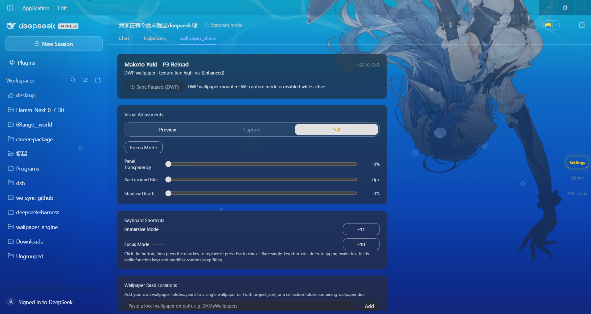
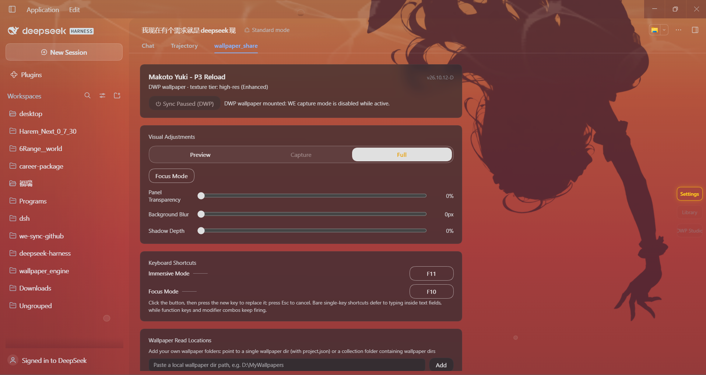

# dsh-wallpaper_share

<div align="center">
  <b>Wallpaper Engine → DeepSeek Harness Web / Desktop</b><br /><br />
  <a href="https://github.com/YRN-playmaker/dsh-wallpaper_share"></a>
  <a href="https://www.npmjs.com/package/dsh-wallpaper_share"></a>
  <a href="https://www.npmjs.com/package/dsh-wallpaper_share"></a>
  <a href="https://github.com/YRN-playmaker/dsh-wallpaper_share/stargazers"></a>
  <a href="https://dsh-plugin.org/plugins/yrn-playmaker/dsh-wallpaper-share"></a>
  <a href="LICENSE"></a><br /><br />
       
</div>

<div align="center">
  <a href="#中文">中文</a> · <a href="#english">English</a>
</div>


<a id="中文"></a>
## 中文

把 Wallpaper Engine（WE）当前壁纸同步为 DeepSeek Harness（DSH）Web / 桌面端界面的背景，在 `wallpaper_share` 标签页调整渲染模式、透明度、模糊、阴影、专注透镜与壁纸库。本次在Harness `0.1.0-rc.6` 与`0.2.0-rc.2`环境完成实际安装与验证。

同步功能读取 WE 状态，不更改桌面壁纸。安装目录会自动检测；眼动追踪在本机推理，摄像头画面不上传。

- [26.10.13-D 更新](#zh-update)
- [DeepSeek 日夜 1.3.2](#zh-daynight)
- [安装与升级](#zh-install)
- [渲染模式与窗口跟随](#zh-render)
- [功能与操作](#zh-features)
- [配置](#zh-config)
- [限制与排查](#zh-troubleshooting)
- [开发与验证](#zh-development)
- [关于我 / 赞助](#zh-support)

<a id="zh-update"></a>
### 26.10.13-D 更新 · 日夜壁纸 1.3.2

1. **突破大文件下载限制**：启动器现在支持通过直链、网盘下载超过 4 GB 的大型软件。支持 ZIP64 和大压缩包的磁盘解压。当前下载上限为 64 GiB，单层展开上限为 128 GiB，需为下载包和解压文件预留磁盘空间。[详细说明](docs/launcher-large-download.md)。
2. **优化背景与主题冲突**：重新调整壁纸、侧边栏和页面的主题衔接，减少叠加遮罩；浅色主题下文字更清晰，进入、退出及切回对话时保持平滑过渡。
3. **一并更新 DeepSeek 日夜主题**： 1.3.2版本 带来更丰富的入水、滚轮下潜、水面焦散和二维气泡动画，并细分预览与完整模式。预览模式下，`wallpaper_share` 页面固定使用白天蓝色背景，不随本地时间切换，并采用开销更低的普通气泡；完整模式保留昼夜切换、夜间暖红水体与完整剪影、水花及按钮变色。





完整记录见 [CHANGELOG.md](CHANGELOG.md)。

<a id="zh-install"></a>
### 安装与升级

需要 DSH Web profile。使用原生场景捕获时，还需要在同一台 Windows 电脑上运行 WE 并应用场景壁纸。

从 GitHub 安装本仓库版本：

```bash
dsh plugin --profile web add github:YRN-playmaker/dsh-wallpaper_share
```

npm 安装（默认推荐 desktop 版本）：

Web 端可通过 npm 的 `web` 标签获取：下方命令中的 `--profile web` 指定 DSH Web profile，`@web` 指定插件的 Web 版本。`web` 标签当前指向 `26.10.3`；如需固定该版本，可将 `@web` 替换为 `@26.10.3`。

```bash
# 默认 desktop 版本（latest 标签，版本号带 -D）
dsh plugin --profile web add dsh-wallpaper_share

# 明确选择 desktop 渠道
dsh plugin --profile web add dsh-wallpaper_share@desktop

# 保留的 Web 版本（web 标签）
dsh plugin --profile web add dsh-wallpaper_share@web

# 自行打包的本地安装包
dsh plugin --profile web add ./dsh-wallpaper_share-26.10.13-D.tgz
```

安装或升级后，**重启 DSH Web profile 并刷新浏览器页面**。默认地址为 `http://127.0.0.1:3080`，实际端口以启动日志为准。仅刷新页面不会更新已加载的后端程序。

新会话的会话区会出现 `wallpaper_share` 标签页；在其中开启同步并选择渲染模式。多显示器可通过「背景显示器」锁定来源。安装包包含前后端及 Windows 原生程序，用户无需自行构建；`cordis.patch.yml` 会随插件安装接入 profile。


<a id="zh-daynight"></a>
### DeepSeek 日夜 1.3.2

1.下载本插件包
2. 在「壁纸库 → 市场」更新日夜壁纸到 **1.3.2**，或导入下载的 DWP，然后重新挂载。
3. 打开 `wallpaper_share` 查看入水；滚轮下潜，再切回对话检查退出过渡。选择「完整」查看焦散和泡泡照明；开启专注后查看呼吸模糊。

人物、水花十帧、U 型展开、剪影渐变、滚轮深度、光效与界面浓度参数均随 DWP 分发，插件负责通用渲染。普通 DWP 播放器继续显示日夜背景；两档纹理及自动昼夜切换保留。系统「减少动态效果」会抑制动态效果。

若未出现新版效果，确认插件为 **26.10.13-D**、壁纸为 **1.3.2**，重启后台后重新挂载。仅更新 DWP 或仅刷新网页不能更新插件渲染器。参数与验证说明见 [页面动画文档](docs/daynight-tab-scene.md)。

<a id="zh-render"></a>
### 渲染模式与窗口跟随

| 模式 | 场景壁纸（scene） | 适用情况 |
| --- | --- | --- |
| **预览**（eco） | 显示静态预览图 | 节省资源 |
| **捕获**（perf，默认） | 镜像 WE 正在渲染的桌面壁纸；不可用时回退浏览器渲染 | 使用 WE 自身的粒子、脚本和 shader 效果 |
| **完整**（enhanced） | 解析 `.pkg`，在浏览器中重绘图层、粒子与骨骼动画 | 不依赖 WE 持续运行；部分复杂效果仍有差异 |

「完整」是模式名称，浏览器渲染器仍是 WE 引擎的子集。

| 壁纸类型 | 预览 | 捕获 / 完整 |
| --- | --- | --- |
| `scene` | 静态预览 | 按上表选择原生捕获或浏览器渲染 |
| `video` | 静态预览 | 播放源视频，支持 HTTP Range |
| `web` | 静态预览 | 在 iframe 中加载源页面 |
| `image` | 静态预览 | 显示源图 |
| `application` / `other` | 静态预览 | 背景回退预览；应用可在壁纸库中管理 |

**窗口跟随仅用于原生 scene 捕获**，在运行 WE 的同一台电脑上生效。小窗口位于屏幕左侧就显示左侧区域，移到右侧就显示右侧区域。鼠标移入页面后自动校准标题栏偏移；全屏时显示整屏。跟随范围由「背景显示器」决定，跨屏使用时请选择对应显示器，窗口超出所选屏幕的部分不会拉伸补齐。

**高 DPI 显示缩放需要 we-capture 0.4.3 或更新版本**，并同步更新前后端。捕获器会按显示器缩放转换屏幕坐标，使背景与窗口所在区域对齐；旧捕获器会提示升级。不提供屏幕坐标的旧捕获器、静态预览及浏览器回退仍居中铺满。原生捕获失败时，场景背景依次回退为浏览器渲染、提取纹理、预览图；当前通路显示在面板副标题。

<a id="zh-features"></a>
### 功能与操作

- **视觉效果**：调整面板透明度、壁纸模糊和阴影；同步开关与渲染偏好会保存到本地。
- **专注透镜**：圆心清晰、圆外模糊，默认跟随鼠标；开启专注后，视觉浓度随任务状态调整。
- **眼动追踪**：可选摄像头推断视线，提供 9 点校准、文字吸附与抗抖动；首次使用需要联网加载模型并授予摄像头权限。关闭眼动或专注时释放摄像头。
- **沉浸模式**：快捷键切换（默认 `F11`，可在面板「快捷键设置」里修改）。开启时先切到新会话并隐藏会话界面、只留壁纸；再按一次、按 `Esc`，或点侧边栏任意按钮退出。
- **专注模式快捷键**：同样可自定义（默认 `F10`），与面板里的「专注模式」按钮等效。
- **壁纸库**：管理本地 DWP、WE 应用与启动器应用；市场支持搜索、筛选、安装与更新。管理模式支持多选卸载 DWP 和启动器应用，Steam 工坊内容不参与批量删除。
- **应用启动器**：支持 HTTP(S) 直链及 139 分享链接，导入 `.zip`、`.7z` 或 `.exe`；智能粘贴可从分享文本识别链接、提取码、解压密码和启动文件。应用在「本地 → 应用」启动，列表显示名称、位置与下载时间。
- **DWP 背景**：挂载自定义壁纸包后由 WebGL2 渲染，低配时回退 Canvas2D；挂载期间暂停 WE 同步。内置工作区脉搏可展示近期文件变化，支持昼夜变量与纹理档位。
- **DeepSeek 日夜侧边栏效果**：使用包含此功能的新版插件，挂载「DeepSeek 日夜」后，普通悬停显示蓝色背景，选中项显示深色鱼剪影游动；品牌按钮除外。系统开启「减少动态效果」时剪影静止。效果随插件提供，无需替换 DWP 包；仅更新壁纸包不会为旧版插件增加此功能。
- **139 登录（桌面端）**：安装 / 更新油猴登录态同步助手，在浏览器登录139网盘并打开文件列表或分享页；从油猴菜单点击「复制 139 登录态（用于桌面端粘贴）」，回到启动器粘贴139分享链接，在自动显示的「139登录态」区域粘贴并保存。随后点击「下载安装」，安装后从应用栏启动（每次确认）。Web端仍可自动同步；其他网盘需提供可下载的直链。

**快捷键设置**

在「视觉效果」与「壁纸读取位置」之间找到「快捷键设置」，点击对应功能右侧的键位按钮，再按下新按键或组合键即可替换；录制中按 `Esc` 取消。录制期间不会触发沉浸或专注切换，设置会自动保存。组合键需要完整匹配，例如绑定 `Ctrl+K` 后单按 `K` 不会触发。在输入框或可编辑文本区域内，普通字符及编辑键让位于输入；`F10`、`F11` 和组合键仍可触发。

当前版本已移除侧边栏 / 右上角状态圆点及桌面悬浮球；专注模式的任务状态响应保留。

**壁纸同步界面**


**专注模式演示**


**壁纸库界面**


**设置面板**


截图用于介绍界面，可能来自旧版本；其中若有状态圆点或桌面悬浮球，已不适用于 26.10.6-D。具体布局以当前版本为准。

<a id="zh-config"></a>
### 配置

常用设置在 `wallpaper_share` 面板中调整。开发或自定义部署可修改 `src/index.ts` 顶部 `CONFIG` 后重新构建：

| 配置项 | 默认值 | 用途 |
| --- | --- | --- |
| `wallpaperEngineDir` | `''` | 自动检测 WE 安装目录，失败时手动指定 |
| `workshopContentDir` | `''` | 自动推导工坊目录 |
| `pollIntervalMs` | `2000` | WE 状态轮询间隔，毫秒 |
| `sceneRendererPath` | `''` | 自动发现随包捕获器，或指定外部 renderer |
| `wallpaperEngineAssetsDir` | `''` | 默认使用 `<weDir>/assets` |
| `sceneRenderWidth` / `sceneRenderHeight` | `1920` / `1080` | 捕获输出分辨率，低于原生尺寸时降采样 |
| `sceneRenderFps` / `sceneRenderQuality` | `30` / `80` | 目标帧率与 JPEG 质量 |
| `sceneRenderMode` | `'auto'` | 后端通路选择：`auto` / `browser` / `external` |
| `particleRateScale` / `particleSizeScale` | `1` / `1` | 浏览器粒子发射率与尺寸倍率 |
| `effectStrengthScale` | `0.6` | 浏览器图层效果强度倍率 |
| `puppetMeshRender` | `true` | 骨骼网格渲染 |
| `workspaceDir` | `''` | 工作区脉搏扫描根，默认插件进程工作目录 |
| `workspacePulseWindowMs` | `90000` | 工作区变化保留时长，毫秒 |
| `workspacePulseAutoInstall` | `true` | 自动安装内置工作区脉搏包 |

后端 `sceneRenderMode` 与面板的三档渲染按钮是不同设置。其余开发配置见源码。

<a id="zh-troubleshooting"></a>
### 限制与排查

- 原生捕获仅支持 Windows；捕获取的是桌面壁纸层，可能包含桌面图标。
- WE 暂停渲染时，捕获动画也暂停；窗口移动仍可重绘最后一帧。实际帧率受 WE 自身帧率、输出分辨率和编码耗时影响。
- 浏览器「完整」模式对复杂 shader、SceneScript 或特定效果的支持仍有限；需要匹配 WE 原始效果时优先选择捕获。
- DWP 挂载期间会暂停 WE 背景同步；眼动追踪依赖摄像头及浏览器安全上下文（localhost 或 HTTPS）。
- 市场和模型资源的网络加载可能失败；本地已安装内容不依赖市场缩略图加载。

出现背景空白、版本未更新或标签页缺失时：

1. 安装或升级后重启 DSH，并刷新页面。
2. 确认 `wallpaper_share` 标签页出现，检查浏览器控制台有无插件加载错误。
3. 查看 `/we-sync/diag` 的显示器、捕获器版本和当前渲染状态；捕获模式下确认 WE 已运行。
4. Windows 显示缩放下背景错位时，确认捕获器为 **0.4.3** 或更新版本；桌面端 Capture 无法连接时，确认已安装包含桌面连接修复的 **26.10.6-D**，并重启宿主以加载新版本。
5. 安装目录检测失败时配置 `wallpaperEngineDir`；反馈问题时附上插件版本、harness 版本和错误信息。

<a id="zh-development"></a>
### 开发与验证

```bash
pnpm install --frozen-lockfile
npm run typecheck
npm test
npm run build
npm run check:package
npm run test:package
npm pack
```

修改原生源码后，在 Windows 上先运行 `npm run build:native`。原生版本与源码指纹必须和 `bin/` 程序一致；含非 ASCII 字符的工具链路径可能导致 GNU 链接器失败，可使用 ASCII 路径并配置 `RUSTUP_HOME` / `CARGO_HOME`。

Chrome 像素回归：

```bash
node tools/test-shake-browser.mjs
node tools/test-particle-browser.mjs
node tools/test-capture-browser.mjs
# Windows + WE 运行时：验证真实捕获帧
node tools/test-capture-browser.mjs --native
```

`lib/index.js` 和 `lib/client.js` 是随包预构建入口。面板版本由 `package.json` 在构建时注入，因此更新版本后必须重新构建。

- `src/scene/`：场景协议、捕获中继、素材解析与骨骼模型。
- `src/client/`：面板、背景层、图层效果、粒子与窗口裁切。
- `native/we-capture/`：Windows 捕获器源码；`bin/` 是随包程序。
- `vendor/dwp/`：DWP 运行时快照；`src/market/`、`src/launcher/` 管理壁纸库与应用。
- `docs/`：格式与实现记录，包括 [scene-fallback.md](docs/scene-fallback.md) 和 [effect-shake.md](docs/effect-shake.md)。

提交与打包前遵守 [AGENTS.md](AGENTS.md) 和 [编码与发布规范](docs/encoding-and-release.md)。`package.json` 必须为 UTF-8 无 BOM；发布验证应使用实际安装包，并确认新会话的前端标签可见。

<a id="zh-support"></a>
### 关于我 / 赞助

我是 [YRN-playmaker](https://github.com/YRN-playmaker)，这个插件的开发者。感谢你使用、反馈问题和分享这个项目。

如果这个插件对你有帮助，欢迎通过 [Ko-fi 支持我](https://ko-fi.com/yrnplaymaker)请我喝杯咖啡，以加速维护、兼容适配与新功能开发提供支持。


---

<a id="english"></a>
## English

Sync the active Wallpaper Engine (WE) wallpaper into the DeepSeek Harness (DSH) Web / Desktop UI. Use the `wallpaper_share` tab to adjust rendering, transparency, blur, shadows, the focus lens and the wallpaper library. This update was installed and tested with Harness `0.1.0-rc.6` and `0.2.0-rc.2`.

Wallpaper sync reads WE state without changing your desktop wallpaper. The installation directory is detected automatically. Eye tracking runs locally; camera frames are not uploaded.

- [What's new in 26.10.13-D](#en-update)
- [DeepSeek Day & Night 1.3.2](#en-daynight)
- [Install and upgrade](#en-install)
- [Render modes and window following](#en-render)
- [Features and controls](#en-features)
- [Configuration](#en-config)
- [Limitations and troubleshooting](#en-troubleshooting)
- [Development and validation](#en-development)
- [About me / Support](#en-support)

<a id="en-update"></a>
### What's new in 26.10.13-D · Day & Night 1.3.2

1. **Downloads above 4 GB:** the launcher supports large software downloads through direct links and cloud drives, with ZIP64 support and disk-based extraction of large archives. Downloads are capped at 64 GiB and each archive layer at 128 GiB expanded; reserve disk space for both the download and extracted files. See [details](docs/launcher-large-download.md).
2. **Fewer wallpaper and theme conflicts:** wallpaper, sidebar and page styling now work together with fewer overlapping masks. Text is clearer in light themes, with smooth transitions when entering, leaving or returning to the conversation.
3. **Updated DeepSeek Day & Night theme:** version 1.3.2 adds richer water entry, scroll-driven diving, surface caustics and 2D bubble animations, with clearer differences between Preview and Full. On the `wallpaper_share` page, Preview keeps the daytime blue background regardless of local time and uses lower-cost bubbles. Full retains day/night switching, warm-red water and a full silhouette at night, with matching splash and button colors.


See [CHANGELOG.md](CHANGELOG.md) for the full history. Repository source reports **26.10.13-D**. As checked on 2026-10-12, npm `latest` / `desktop` point to **26.10.9-D** and `web` to **26.10.3**; these channels do not include this water-entry page fix.

<a id="en-install"></a>
### Install and upgrade

A DSH Web profile is required. Native scene capture also requires WE to be running with a scene wallpaper on the same Windows computer.

Install this repository version from GitHub:

```bash
dsh plugin --profile web add github:YRN-playmaker/dsh-wallpaper_share
```

npm installation (desktop is the recommended default):

To get the Web version, use the npm `web` tag: `--profile web` selects the DSH Web profile, while `@web` selects the plugin's Web version. The `web` tag currently points to `26.10.3`; replace `@web` with `@26.10.3` to pin that version.

```bash
# Default desktop version (latest tag, -D version suffix)
dsh plugin --profile web add dsh-wallpaper_share

# Explicit desktop channel
dsh plugin --profile web add dsh-wallpaper_share@desktop

# Preserved Web version (web tag)
dsh plugin --profile web add dsh-wallpaper_share@web

# A locally packed installation archive
dsh plugin --profile web add ./dsh-wallpaper_share-26.10.13-D.tgz
```

After installing or upgrading, **restart the DSH Web profile and refresh the browser page**. The default address is `http://127.0.0.1:3080`; check the startup log for the actual port. Refreshing the page alone does not reload the backend.

Open a new session and find the `wallpaper_share` tab in the session area. Enable sync and choose a render mode there. With multiple displays, use **Background monitor** to select the source. The package includes prebuilt frontend, backend and Windows native programs, so users do not need to build it. Its `cordis.patch.yml` is added to the profile during installation.


<a id="en-daynight"></a>
### DeepSeek Day & Night 1.3.2

1. Download `deepseek-day-night.dwp` and this plugin package from the [1.3.2 release](https://github.com/YRN-playmaker/dwp-releases/releases/tag/deepseek-day-night-1.3.2).
2. Install the plugin, restart the DSH Web profile and refresh the page:

   ```bash
   dsh plugin --profile web add ./dsh-wallpaper_share-26.10.13-D.tgz
   ```

3. Update the wallpaper to **1.3.2** in **Wallpaper Library → Market**, or import the downloaded DWP, then remount it.
4. Open `wallpaper_share` to view water entry, scroll to dive, then return to the conversation to check the exit transition. Select Full for caustics and bubble lighting; enable Focus to see breathing blur.

The portrait, ten splash frames, U-shaped reveal, silhouette gradient, scroll depth, lighting and UI intensity settings ship inside the DWP. The plugin supplies a generic renderer. Standard DWP players retain the day/night background, both texture tiers and automatic switching. Reduced-motion preferences suppress motion.

If the new effects are missing, confirm plugin **26.10.13-D** and wallpaper **1.3.2**, restart the backend and remount. Updating the DWP or refreshing the browser alone does not update the renderer. See [tab-scene documentation](docs/daynight-tab-scene.md).

<a id="en-render"></a>
### Render modes and window following

| Mode | Scene wallpapers | Use case |
| --- | --- | --- |
| **Preview** (eco) | Static preview image | Lowest resource use |
| **Capture** (perf, default) | Mirrors the desktop wallpaper rendered by WE; falls back to browser rendering when unavailable | WE's own particles, scripts and shader effects |
| **Full** (enhanced) | Parses `.pkg` files and redraws layers, particles and skeletal animation in the browser | Works without WE continuously running; some complex effects still differ |

Full is the mode's name; the browser renderer remains a subset of the WE engine.

| Wallpaper type | Preview | Capture / Full |
| --- | --- | --- |
| `scene` | Static preview | Native capture or browser rendering, as above |
| `video` | Static preview | Source video playback with HTTP Range support |
| `web` | Static preview | Source page in an iframe |
| `image` | Static preview | Source image |
| `application` / `other` | Static preview | Preview background; apps are managed in the library |

**Window following applies to native scene capture only**, on the computer running WE. A window on the left shows the left desktop region; moving it right shows the right region. Moving the pointer into the page calibrates the browser chrome offset. Fullscreen shows the whole display. **Background monitor** sets the capture boundary: select the corresponding monitor when moving between displays. Areas beyond the selected display are not filled by stretching its edges.

High-DPI display scaling requires **we-capture 0.4.3 or newer**, with both frontend and backend updated. The capture program converts screen coordinates using the display scale to align the background with the window; older versions show an upgrade hint. Older capture programs without screen geometry, static previews and browser fallback still use a centered cover layout. When native capture fails, the scene background falls back through browser rendering, extracted textures and the preview image. The panel subtitle identifies the active path.

<a id="en-features"></a>
### Features and controls

- **Visual controls:** panel transparency, wallpaper blur and shadows. Sync and rendering preferences are saved locally.
- **Focus lens:** a clear center with a blurred surrounding area, following the pointer by default. Visual intensity adapts to task activity when focus is enabled.
- **Eye tracking:** optional camera-based gaze tracking with nine-point calibration, text snapping and smoothing. First use needs a network connection to load the model and camera permission. Disabling eye tracking or focus releases the camera.
- **Immersive mode:** switched by a hotkey (default `F11`, rebindable in the panel's Keyboard Shortcuts section). Entering switches to a new session and hides the conversation UI, leaving only the wallpaper; press the hotkey again, press `Esc`, or click any sidebar button to exit.
- **Focus mode hotkey:** also rebindable (default `F10`) and equivalent to the panel's Focus Mode button.
- **Wallpaper library:** manage local DWP packages, WE apps and launcher apps. The market supports search, filters, installation and updates. Management mode allows bulk uninstall of DWP and launcher apps; Steam workshop content is excluded from bulk deletion.
- **App launcher:** import `.zip`, `.7z` or `.exe` files using HTTP(S) direct links or 139 share links. Smart Paste detects the link, share passcode, archive password and launch file from a share post. Launch apps from **Local → Apps**; the list shows name, location and download time.
- **DWP backgrounds:** custom wallpaper packages render through WebGL2 with a Canvas2D fallback. WE background sync pauses while a DWP is mounted. The built-in Workspace Pulse displays recent file changes; day/night variables and texture tiers are supported.
- **DeepSeek Day & Night sidebar effects:** with a plugin release containing this feature, mounting this wallpaper enables blue hover backgrounds and dark swimming fish on selected items, excluding the brand button. Reduced-motion preferences keep the fish still. The effect ships with the plugin; updating only the DWP package does not add it to older plugin versions.
- **139 login (desktop):** install/update the Tampermonkey login helper, sign in to 139 and open its file list or share page. Choose “复制 139 登录态（用于桌面端粘贴）” in the helper menu, then paste the 139 share link in App Launcher. Paste and save the login state in the section that appears automatically, then install. Launching an installed app still asks for confirmation each time. Web auto-sync remains available; other drives require a downloadable direct URL.

**Keyboard Shortcuts**

Find Keyboard Shortcuts between Visual Effects and Wallpaper Read Locations. Click the binding button beside a function, then press a new key or key combination; press `Esc` to cancel recording. Immersive and focus shortcuts are suspended during recording, and new bindings are saved automatically. Modifiers must match exactly: `K` alone does not trigger a `Ctrl+K` binding. In input fields and editable text, plain character and editing keys are reserved for typing; `F10`, `F11` and key combinations still work.

Sidebar / top-right status dots and the desktop floater have been removed. Focus mode still responds to task activity.

**Wallpaper sync**


**Focus mode demonstration**


**Wallpaper library**


**Settings panel**


These screenshots may show older versions. Any status dots or desktop floater shown are no longer available in 26.10.6-D; refer to the current interface for the layout.

<a id="en-config"></a>
### Configuration

Use the `wallpaper_share` panel for common settings. For development or custom deployments, edit `CONFIG` at the top of `src/index.ts` and rebuild:

| Key | Default | Purpose |
| --- | --- | --- |
| `wallpaperEngineDir` | `''` | Detect WE automatically; set manually if detection fails |
| `workshopContentDir` | `''` | Infer the workshop directory |
| `pollIntervalMs` | `2000` | WE state polling interval in milliseconds |
| `sceneRendererPath` | `''` | Discover the shipped capture program, or specify an external renderer |
| `wallpaperEngineAssetsDir` | `''` | Uses `<weDir>/assets` by default |
| `sceneRenderWidth` / `sceneRenderHeight` | `1920` / `1080` | Capture output resolution; downsample when below native size |
| `sceneRenderFps` / `sceneRenderQuality` | `30` / `80` | Target frame rate and JPEG quality |
| `sceneRenderMode` | `'auto'` | Backend path: `auto` / `browser` / `external` |
| `particleRateScale` / `particleSizeScale` | `1` / `1` | Browser particle emission rate and size multipliers |
| `effectStrengthScale` | `0.6` | Browser layer-effect strength multiplier |
| `puppetMeshRender` | `true` | Skeletal mesh rendering |
| `workspaceDir` | `''` | Workspace Pulse root; defaults to the plugin process working directory |
| `workspacePulseWindowMs` | `90000` | File-change retention in milliseconds |
| `workspacePulseAutoInstall` | `true` | Automatically install the built-in Workspace Pulse package |

Backend `sceneRenderMode` is separate from the panel's three-mode switch. See the source for additional development options.

<a id="en-troubleshooting"></a>
### Limitations and troubleshooting

- Native capture requires Windows. Capture mirrors the desktop wallpaper layer and may include desktop icons.
- When WE pauses rendering, captured animation pauses too; moving the window still redraws the corresponding region of the last frame. Actual frame rate depends on WE's own frame rate, output resolution and encoding cost.
- The browser Full renderer has limited support for some complex shaders, SceneScript and effects. Prefer Capture when matching WE's original output matters.
- Mounting a DWP pauses WE background sync. Eye tracking needs a camera and a secure browser context such as localhost or HTTPS.
- Market and model assets may fail to load over the network. Installed local content does not depend on loading market thumbnails.

If the background is blank, the version looks old or the tab is missing:

1. Restart DSH after installing or upgrading, then refresh the page.
2. Check that `wallpaper_share` appears and inspect the browser console for plugin-loading errors.
3. Check `/we-sync/diag` for monitors, capture version and render status. Make sure WE is running when using Capture.
4. For wallpaper misalignment with Windows display scaling, check that the capture program is **0.4.3** or newer. For failed desktop Capture connections, install **26.10.6-D** with the desktop connection fix and restart the host.
5. Set `wallpaperEngineDir` if detection fails. Include the plugin version, harness version and error text when reporting a problem.

<a id="en-development"></a>
### Development and validation

```bash
pnpm install --frozen-lockfile
npm run typecheck
npm test
npm run build
npm run check:package
npm run test:package
npm pack
```

After changing native source, run `npm run build:native` on Windows first. Native versions and source fingerprints must match the programs in `bin/`. Non-ASCII toolchain paths can break the GNU linker; use an ASCII path and configure `RUSTUP_HOME` / `CARGO_HOME` if needed.

Chrome pixel regressions:

```bash
node tools/test-shake-browser.mjs
node tools/test-particle-browser.mjs
node tools/test-capture-browser.mjs
# Windows with WE running: validate actual captured frames
node tools/test-capture-browser.mjs --native
```

`lib/index.js` and `lib/client.js` are the shipped prebuilt entry points. The panel version is injected from `package.json` at build time, so rebuild after changing it.

- `src/scene/`: scene protocol, capture relay, asset parsing and skeletal models.
- `src/client/`: panel, background layers, effects, particles and viewport cropping.
- `native/we-capture/`: Windows capture source; `bin/` contains shipped programs.
- `vendor/dwp/`: DWP runtime snapshot; `src/market/` and `src/launcher/` manage wallpapers and apps.
- `docs/`: format and implementation notes, including [scene-fallback.md](docs/scene-fallback.md) and [effect-shake.md](docs/effect-shake.md).

Follow [AGENTS.md](AGENTS.md) and the [encoding and release rules](docs/encoding-and-release.md) before committing or packaging. `package.json` must be UTF-8 without a BOM. Validate the actual installation archive and confirm that the frontend tab appears in a new session.

<a id="en-support"></a>
### About me / Support

I’m [YRN-playmaker](https://github.com/YRN-playmaker), the developer of this plugin. Thank you for using it, reporting issues and sharing the project.

If this plugin helps you, consider [buying me a coffee on Ko-fi](https://ko-fi.com/yrnplaymaker) to support maintenance, compatibility improvements and new features.

---

## License

[GPL-3.0](LICENSE)
